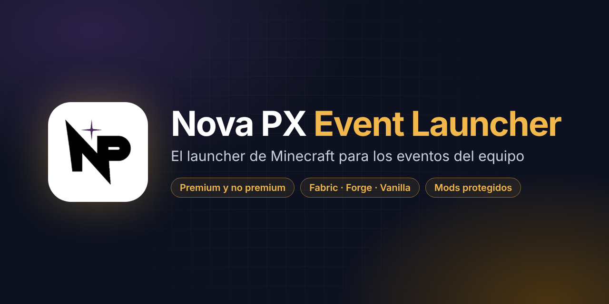
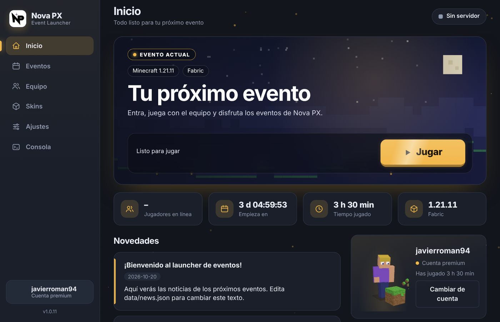
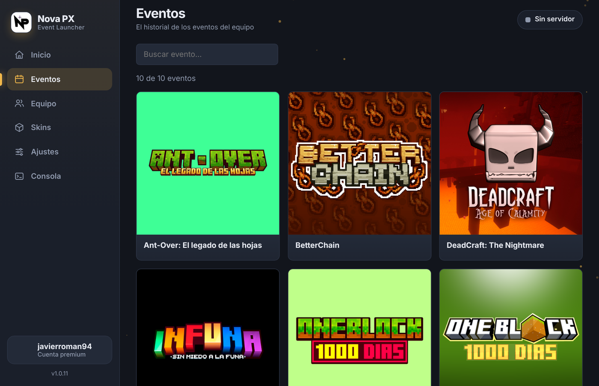
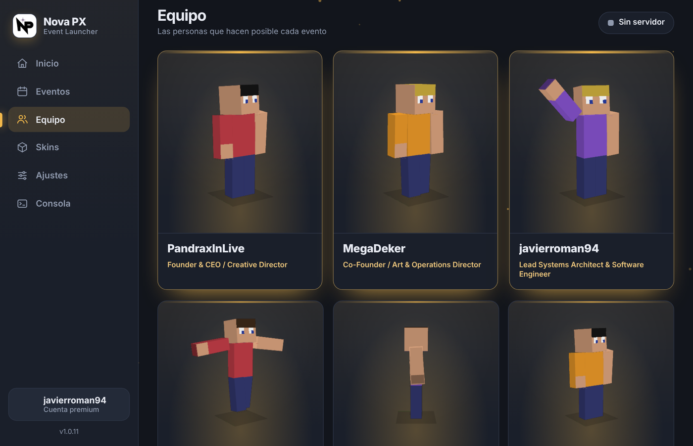
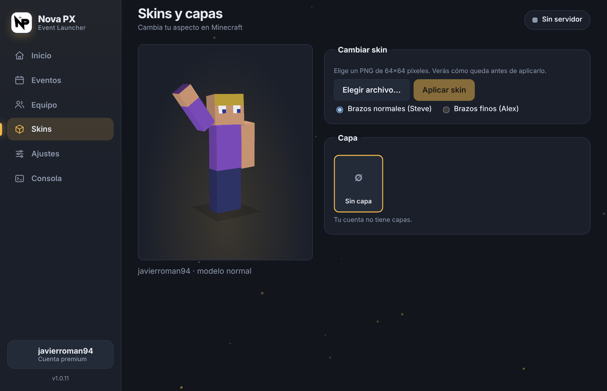
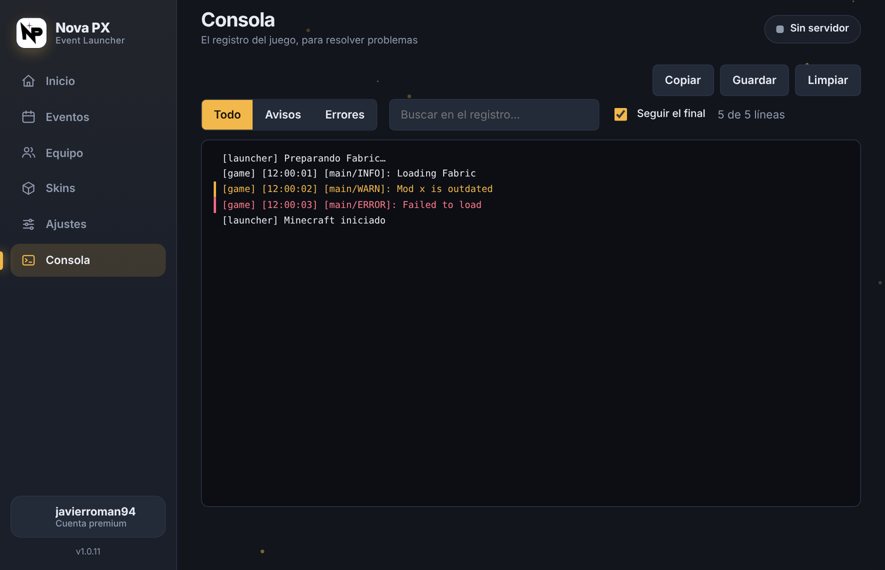

<div align="center">



<br />

[](https://github.com/javierroman94/Nova-PX-Event-Launcher/releases/latest)
[](https://github.com/javierroman94/Nova-PX-Event-Launcher/releases)
[](https://github.com/javierroman94/Nova-PX-Event-Launcher/actions)


**[⬇️ Descargar la última versión](https://github.com/javierroman94/Nova-PX-Event-Launcher/releases/latest)** · [📖 Guía completa](docs/GUIA.md) · [💬 Discord](https://discord.gg/VAfuFEQtjv)

</div>

---

## ✨ Qué es

El launcher oficial de **Nova PX** para jugar sus eventos de Minecraft. El jugador lo instala **una sola vez**: después, las noticias, los eventos, el equipo y los mods se actualizan solos desde este repositorio, y el propio programa se actualiza cuando publicamos una versión nueva.

<div align="center">

<br /><sub>Capturas con datos de ejemplo.</sub>
</div>

## 🚀 Características

| | |
|---|---|
| 🔐 **Premium y no premium** | Inicio de sesión con Microsoft o con un nick local. La sesión se recuerda al cerrar el launcher. |
| 🧩 **Vanilla, Fabric y Forge** | Instala el loader y la versión de Minecraft del evento sin que el jugador toque nada. |
| 🛡️ **Mods protegidos** | Los mods viajan cifrados (AES-256-GCM). Se pide una contraseña solo en la primera instalación. |
| ☕ **Java automático** | Si el equipo no tiene el Java correcto, el launcher lo descarga e instala. |
| 🎮 **Una carpeta por evento** | Cada evento vive en su propia instancia: los mods de uno no chocan con los de otro. |
| 🧍 **Skins en 3D** | Visor 3D con animaciones, cambio de skin y de capa para cuentas premium. |
| 🎨 **Temas y efectos** | Tema oscuro/claro, color principal, fondo propio y efectos que se pueden apagar. |
| 💬 **Discord Rich Presence** | Muestra en Discord a qué evento estás jugando y cuánto tiempo llevas. |
| 🔄 **Actualizaciones automáticas** | El contenido se lee de GitHub al abrir; el programa se actualiza solo con cada versión. |
| 🩺 **Diagnóstico** | Consola con filtros, análisis de cierres inesperados y botón de **Reparar instalación**. |
| 🔔 **Avisos de evento** | Notificación de escritorio una hora antes de que empiece un evento. |
| 🪶 **Ligero** | Se minimiza a la bandeja y libera memoria mientras juegas. |

## 🖼️ Capturas

<table>
<tr>
<td width="50%"><br /><sub><b>Eventos</b> · historial con búsqueda y ficha</sub></td>
<td width="50%"><br /><sub><b>Equipo</b> · skins en 3D con animaciones</sub></td>
</tr>
<tr>
<td width="50%"><br /><sub><b>Skins y capas</b> · vista previa antes de aplicar</sub></td>
<td width="50%"><br /><sub><b>Consola</b> · registro con filtros por nivel</sub></td>
</tr>
</table>

## 📥 Instalación (jugadores)

1. Entra a **[Releases](https://github.com/javierroman94/Nova-PX-Event-Launcher/releases/latest)** y descarga el instalador para tu sistema (`.exe` en Windows, `.AppImage` en Linux).
2. Ábrelo e instala. Windows puede mostrar un aviso de "editor desconocido" porque el instalador aún no está firmado: pulsa **Más información → Ejecutar de todas formas**.
3. Inicia sesión y pulsa **Jugar**. No necesitas instalar Java ni descargar mods a mano.

## 🛠️ Para el equipo (desarrollo)

Requisitos: [Node.js](https://nodejs.org) LTS.

```bash
npm install
npm start        # abre el launcher en modo desarrollo
npm test         # ejecuta las pruebas
```

El contenido se edita **sin tocar el programa**, en la carpeta [`data/`](data):

| Archivo | Qué controla |
|---|---|
| `manifest.json` | Evento actual, versión de Minecraft, loader, servidor y mods |
| `events.json` | Historial de eventos (nombre, fecha, imagen, descripción) |
| `team.json` | Miembros del equipo y sus cargos |
| `news.json` | Noticias de la pantalla de inicio |

Para publicar una versión nueva del programa:

```bash
git tag v1.0.12
git push origin v1.0.12
```

GitHub Actions compila el instalador y lo publica en **Releases**; los launchers instalados lo descargan solos. Todo el detalle (mods cifrados, Forge, servidor, instancias, Discord) está en la **[Guía completa](docs/GUIA.md)**.

## 🧱 Estructura

```
main.js · preload.js      Proceso principal de Electron
renderer/                 Interfaz (HTML, CSS, JS, visor 3D en WebGL)
lib/                      Loaders, cifrado del modpack, Java, skins, Discord, instancias
data/                     Contenido editable (se lee desde GitHub)
tools/                    Utilidades (generar mods cifrados)
test/                     Pruebas automáticas
docs/                     Guía y capturas
```

## 👥 Equipo

Hecho por el equipo de **Nova PX** · [Discord](https://discord.gg/VAfuFEQtjv) · [X](https://x.com/NovaPX_)

<sub>Nova PX Event Launcher no está afiliado a Mojang Studios ni a Microsoft. Minecraft es una marca de Mojang Studios.</sub>
