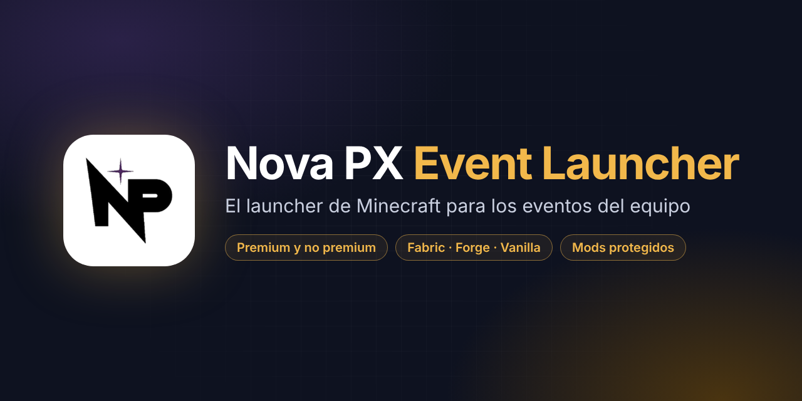
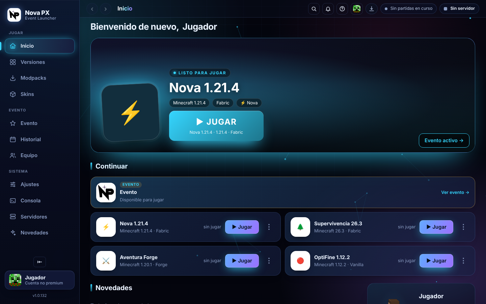
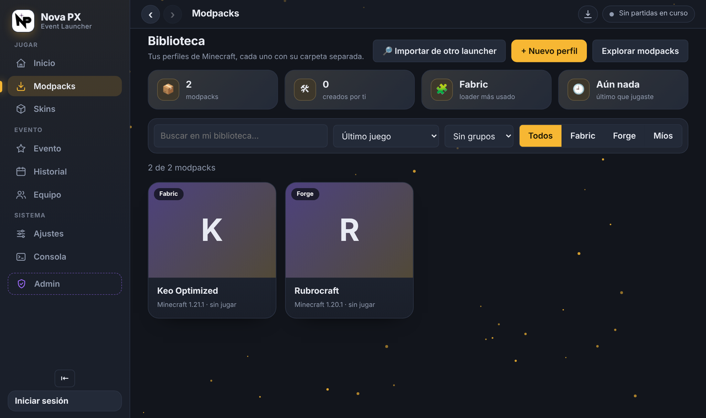
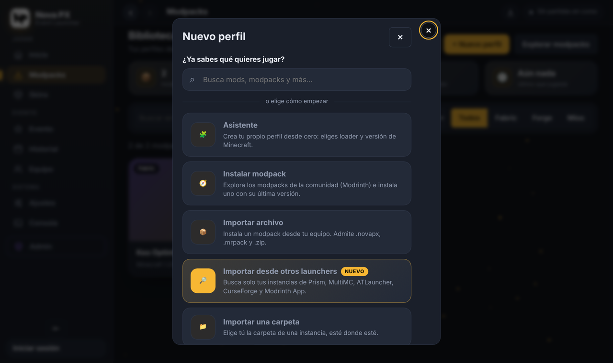
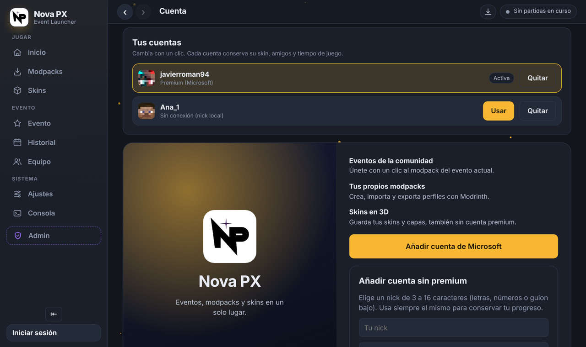
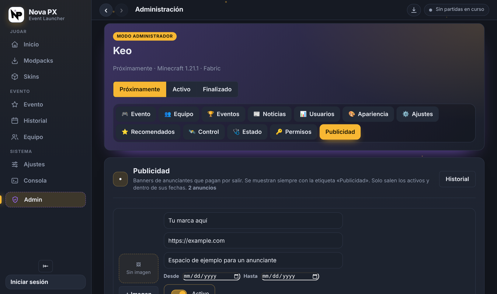
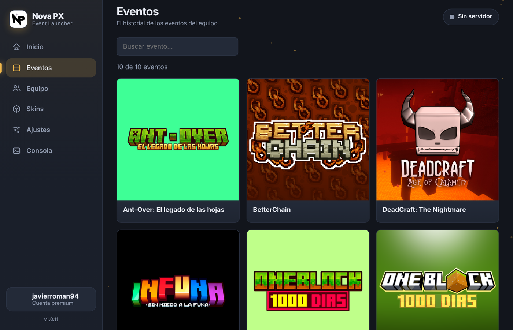
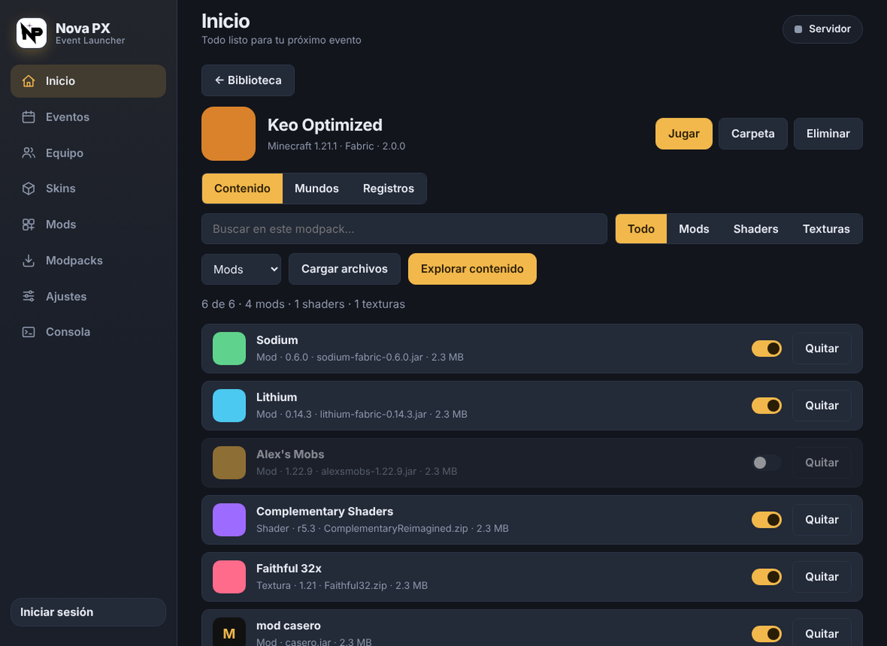

<div align="center">



# Nova PX Event Launcher

**El launcher de Minecraft para los eventos de la comunidad Nova PX.**<br />
Instálalo una vez y juega: eventos, modpacks, skins y amigos en un solo lugar.

[](https://github.com/javierroman94/Nova-PX-Event-Launcher/releases/latest)
[](https://github.com/javierroman94/Nova-PX-Event-Launcher/releases)
[](https://github.com/javierroman94/Nova-PX-Event-Launcher/actions)
[](LICENSE)


### [🪟 Obtener en Microsoft Store](https://apps.microsoft.com/detail/9mvjl4gf5wj8) · [⬇️ Descargar para Windows y Linux](https://github.com/javierroman94/Nova-PX-Event-Launcher/releases/latest)

[📖 Guía completa](docs/GUIA.md) · [💬 Discord](https://discord.gg/VAfuFEQtjv) · [𝕏 @NovaPX_](https://x.com/NovaPX_) · [🧾 Historial de cambios](CHANGELOG.md)

<br />


<br /><sub>Capturas con datos de ejemplo.</sub>

</div>

---

## ✨ Por qué Nova PX Launcher

El jugador lo instala **una sola vez**. Después, las noticias, los eventos, el equipo y los mods se actualizan solos desde este repositorio, y el propio programa se actualiza cuando publicamos una versión nueva. Sin instalar Java, sin descargar mods a mano.

<table>
<tr>
<td width="33%" valign="top">

### 🎮 Jugar
- Sesión con **Microsoft o nick local**, y **varias cuentas** a un clic
- Loader y versión del evento sin tocar nada (**Vanilla, Fabric, Forge**)
- **Java automático** si falta
- Una carpeta por evento, sin choques entre mods
- **Estado del servidor** y jugadores en línea

</td>
<td width="33%" valign="top">

### 📦 Modpacks
- Biblioteca con **Modrinth**, filtros y grupos
- **Importa desde Prism, MultiMC, ATLauncher, CurseForge y Modrinth App** con un clic, y modpacks `.zip` de CurseForge, `.mrpack` de Modrinth y el catálogo de FTB
- **Forge y NeoForge** (1.20.2 en adelante) además de Fabric y Vanilla
- Mods, shaders y texturas: activa, quita y **actualiza** (con aviso)
- RAM, Java y cuenta **por modpack**; respaldo de mundos
- Exporta un `.novapx` para compartir
- **Crear instancia** con icono propio, loader en botones y versión de Minecraft
- **Panel de descargas** arriba, con historial (modpacks, importaciones y actualizaciones)

</td>
<td width="33%" valign="top">

### 🌐 Comunidad
- **Skins en 3D**, cambio de skin y capa
- **Amigos y chat**, estado en línea
- Equipo, historial de eventos y noticias
- **Discord Rich Presence**
- Avisos de escritorio antes de cada evento

</td>
</tr>
</table>

## 🖼️ Capturas

<table>
<tr>
<td width="50%"><br /><sub><b>Biblioteca</b> · resumen, filtros y tarjetas grandes</sub></td>
<td width="50%"><br /><sub><b>Nuevo perfil</b> · crea, instala o importa desde otros launchers</sub></td>
</tr>
<tr>
<td width="50%"><br /><sub><b>Cuentas</b> · cambia entre Microsoft y sin conexión</sub></td>
<td width="50%"><br /><sub><b>Admin</b> · patrocinadores, publicidad y estadísticas</sub></td>
</tr>
<tr>
<td width="50%"><br /><sub><b>Eventos</b> · historial con búsqueda y ficha</sub></td>
<td width="50%"><br /><sub><b>Modpack</b> · mods, shaders y texturas</sub></td>
</tr>
</table>

## 🔧 Más funciones

| | |
|---|---|
| 🛡️ **Mods protegidos** | Los mods del evento viajan cifrados (AES-256-GCM); la contraseña se pide solo en la primera instalación. |
| 🎨 **Temas y temporadas** | Oscuro, claro, OLED y **Nova Neón** (animado). Decoración automática por temporada (Halloween, Navidad, San Valentín, Carnaval…), estela del cursor propia de cada tema y criaturas pixeladas paseando por la pantalla. |
| 🌍 **Idiomas** | Paquetes de idioma (inglés incluido); la comunidad puede añadir más con un `.json`. |
| 🧭 **Asistente de primer uso** | Te guía: cuenta, RAM recomendada según tu equipo y listo. |
| 🐼 **PX, la mascota** | El panda de NovaPX reacciona al lanzador (saluda, se duerme, comenta cuando abres el juego o terminas un modpack). Se puede apagar en Ajustes. |
| 🤖 **PX AI (opcional)** | PX puede charlar, bromear y ayudarte con errores del juego. Es opt-in, con límite diario y sin datos personales; el detalle está en [`PRIVACY.md`](PRIVACY.md). |
| ⚡ **Nova Client** | Los perfiles Nova instalan el mod propio con menú en el juego (Shift derecho) y módulos FPS, CPS, coordenadas, teclas, armadura y zoom. |
| 🩺 **Diagnóstico** | Consola con filtros, análisis de cierres inesperados y **Reparar instalación**. |
| 🪶 **Ligero** | Se minimiza a la bandeja y libera memoria mientras juegas. |
| 📊 **Estadísticas opcionales** | Contador anónimo gratis en Cloudflare, sin IP; cada jugador puede apagarlo. Ver [`docs/CLOUDFLARE.md`](docs/CLOUDFLARE.md). |
| 🛰️ **Modo administrador** | Crea el modpack, pruébalo y publícalo como evento con un botón; edita equipo, noticias, eventos, patrocinadores y publicidad. |
| 🖥️ **Servidores de prueba** | Para administradores: crea un servidor Vanilla, Paper, Purpur, Spigot, Fabric, Forge o NeoForge en tu PC, instala plugins, mods y datapacks desde Modrinth, Hangar y SpigotMC, pruébalo y expórtalo a tu host. |

## 📥 Instalación (jugadores)

**Windows (recomendado):** instálalo desde la **[Microsoft Store](https://apps.microsoft.com/detail/9mvjl4gf5wj8)**. Lo distribuye Microsoft, sin el aviso de «editor desconocido» del instalador suelto, y se actualiza solo.

**Otras opciones:**

1. Entra a **[Releases](https://github.com/javierroman94/Nova-PX-Event-Launcher/releases/latest)** y descarga el instalador (`.exe` en Windows, `.AppImage` en Linux).
2. Ábrelo e instala. El `.exe` de GitHub aún no está firmado y Windows puede avisar de «editor desconocido»: pulsa **Más información → Ejecutar de todas formas**.

Después, inicia sesión y pulsa **Jugar**.

## 🛠️ Para el equipo (desarrollo)

Requisitos: [Node.js](https://nodejs.org) LTS.

```bash
npm install
npm start        # abre el launcher en modo desarrollo
npm test         # ejecuta las pruebas
```

El contenido se edita **sin tocar el programa**, en la carpeta [`data/`](data):

| Archivo | Qué controla |
|---|---|
| `manifest.json` | Evento actual, versión de Minecraft, loader, servidor, mods y patrocinadores |
| `events.json` | Historial de eventos (nombre, fecha, imagen, descripción) |
| `team.json` | Miembros del equipo y sus cargos |
| `news.json` | Noticias de la pantalla de inicio |
| `ads.json` | Publicidad (anunciante, imagen, enlace, fechas) |
| `launcher.json` | Marca, tema, avisos y funciones (se edita desde el panel administrador) |

Para publicar una versión nueva del programa:

```bash
git tag v1.0.33
git push origin v1.0.33
```

GitHub Actions compila el instalador y lo publica en **Releases**; los launchers instalados lo descargan solos. Detalles (mods cifrados, Forge, servidor, instancias, Discord) en la **[Guía completa](docs/GUIA.md)**.

### 🛰️ Modo administrador

No aparece para los jugadores normales. Se activa en **Ajustes → Modo administrador** con un token de GitHub de acceso limitado y una cuenta premium autorizada. Los colaboradores de otra cuenta usan un token *classic* con permiso `public_repo` (los fine-grained no pueden apuntar a repositorios de otra persona). Más detalle en la [Guía](docs/GUIA.md); Microsoft en [`docs/MICROSOFT.md`](docs/MICROSOFT.md).

## ❓ Preguntas frecuentes

**¿Windows dice «editor desconocido»?** El instalador aún no está firmado. Pulsa *Más información → Ejecutar de todas formas*.

**¿Necesito instalar Java?** No, el launcher descarga el que cada versión necesita.

**¿Puedo usar mis modpacks de otros launchers?** Sí: *Nuevo perfil → Importar desde otros launchers* busca tus instancias de Prism, MultiMC, ATLauncher, CurseForge App y Modrinth App y las copia (las originales no se tocan). También acepta `.mrpack`, `.novapx` y zips.

**¿Puedo tener varias cuentas?** Sí, de Microsoft y sin conexión, y cada modpack puede recordar con cuál se juega.

**¿Qué datos se envían?** Solo un contador anónimo opcional que puedes apagar en Ajustes. Ver [PRIVACY.md](PRIVACY.md).

## 🧱 Estructura

```
main.js · preload.js      Proceso principal de Electron
renderer/                 Interfaz (HTML, CSS, JS, visor 3D en WebGL)
lib/                      Loaders, cifrado, Java, skins, Discord, instancias, importadores, admin, GitHub
worker/                   Contador y amigos (Cloudflare Worker)
data/                     Contenido editable (se lee desde GitHub)
tools/                    Utilidades (generar mods cifrados)
test/                     Pruebas automáticas
docs/                     Guía, Cloudflare, Microsoft y capturas
```

## 👥 Equipo y comunidad

La mascota de NovaPX (el panda rosa) es un diseño de [@DekerModMaker](https://x.com/DekerModMaker).

Hecho por el equipo de **Nova PX** · [Cómo colaborar](CONTRIBUTING.md) · [Discord](https://discord.gg/VAfuFEQtjv) · [X](https://x.com/NovaPX_)

## 📄 Licencia

El código es de código abierto bajo la licencia [MIT](LICENSE). El nombre «Nova PX», su logo y las imágenes de los eventos son de sus autores y no están incluidos en esa licencia. Política de firma: [CODE_SIGNING_POLICY.md](CODE_SIGNING_POLICY.md) · Privacidad: [PRIVACY.md](PRIVACY.md).

<sub>Nova PX Event Launcher no está afiliado a Mojang Studios ni a Microsoft. Minecraft es una marca de Mojang Studios.</sub>

## Code signing

Free code signing provided by [SignPath.io](https://about.signpath.io/), certificate by [SignPath Foundation](https://signpath.org/).
