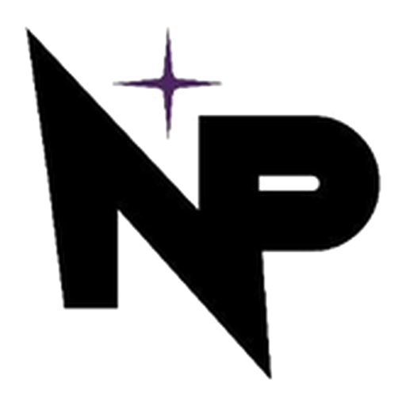

# Guía completa - Nova PX Event Launcher

<p align="center"></p>

Launcher de Minecraft Java para los eventos de Nova PX. Al abrirse muestra una animación de inicio con el logo (se salta con un clic o una tecla). Soporta jugadores **premium** (login Microsoft) y **no premium** (nick local), instala Fabric y los mods del evento automáticamente, y muestra noticias, historial de eventos y el equipo con sus skins.

## 1. Probarlo en tu computadora (paso a paso)

Necesitas internet la primera vez para `npm install`.

1. Instala **Node.js** (versión LTS) desde https://nodejs.org
2. Instala **Java 17 o 21** (necesario para que Minecraft 1.20.x arranque).
3. Abre una terminal dentro de esta carpeta (`event-launcher`) y ejecuta:

```
npm install
npm start
```

Se abrirá el launcher. Entra en **Cuenta**, elige premium o no premium y pulsa **JUGAR**.

## 2. Actualizaciones automáticas

Hay dos tipos de cambio y cada uno se actualiza de forma distinta. En los dos casos **el jugador no descarga nada a mano**: solo instala una vez el launcher.

| Qué cambias | Cómo llega a los jugadores | Qué haces tú |
|---|---|---|
| **Contenido**: noticias, eventos, equipo, evento actual, imágenes, lista de mods, IP del servidor | Al abrir el launcher se lee directo de GitHub (carpeta `data/`). Sin internet usa la última copia guardada. | Editas el archivo en GitHub y lo guardas ("Commit changes"). Sin más pasos. |
| **El programa**: diseño, botones, funciones nuevas | El launcher detecta la versión nueva, la descarga solo y muestra un aviso "Reiniciar e instalar". | Publicas una versión (ver abajo). GitHub compila el instalador solo. |

### Primera vez: instalar el launcher en los jugadores
1. Sube el proyecto al repositorio `javierroman94/Nova-PX-Event-Launcher` (rama `main`).
2. Publica la primera versión (siguiente apartado). GitHub crea el instalador en la pestaña **Releases**.
3. Reparte el enlace de ese instalador (`.exe` para Windows, `.AppImage` para Linux). Los jugadores lo instalan una sola vez.

### Publicar una versión nueva del programa
Desde una terminal dentro de la carpeta del proyecto:

```
npm version patch
git push --follow-tags
```

- `npm version patch` sube el número (0.1.0 → 0.1.1) y crea la etiqueta `v0.1.1`. Usa `minor` para cambios grandes (0.1.0 → 0.2.0).
- Al llegar la etiqueta a GitHub, el flujo `.github/workflows/release.yml` compila los instaladores de Windows y Linux y los publica en **Releases**. Tarda unos 5 a 10 minutos.
- Los launchers instalados comprueban si hay versión nueva al abrir y cada 30 minutos. También hay un botón en **Ajustes > Actualizaciones**. Si el jugador está en partida, la instalación espera a que cierre Minecraft.

Para compilar un instalador en tu propia computadora (sin GitHub) sigue existiendo `npm run dist`; queda en la carpeta `dist/`. Esa vía no publica la actualización automática.

Notas:
- Las actualizaciones automáticas funcionan en **Windows y Linux (AppImage)**. En Mac exigen una cuenta de desarrollador de Apple de pago, así que no están incluidas.
- Sin firma de código, Windows muestra el aviso "editor desconocido" al instalar por primera vez. Las actualizaciones posteriores no lo repiten.
- El repositorio debe ser **público** para que los launchers lean los datos y las versiones sin iniciar sesión. No guardes contraseñas ni claves en él.
- **Quien pueda escribir en el repositorio controla lo que se descarga en los jugadores** (mods y versiones del programa). Activa la verificación en dos pasos en tu cuenta de GitHub y no des acceso de escritura a quien no sea de confianza.

## 3. Qué editar (sin saber programar)

| Archivo | Para qué sirve |
|---|---|
| `config/launcher.config.json` | Nombre del launcher, carpeta del juego, RAM por defecto, ruta de Java |
| `data/news.json` | Noticias de la pantalla de inicio |
| `data/events.json` | Historial de eventos realizados |
| `data/team.json` | Miembros del equipo (nick y rol; la skin se obtiene sola por el nick) |
| `data/manifest.json` | Nombre y frase del evento (`event`), versión de Minecraft, Fabric, IP del servidor y lista de mods |

Cada jugador también tiene su propia pantalla de **Ajustes** dentro del launcher: memoria RAM, ruta de Java, argumentos de Java, tamaño de ventana, pantalla completa, entrar directo al servidor y abrir la carpeta del juego. La pestaña **Consola** muestra el registro de Minecraft para detectar errores (con botones para copiar y limpiar). El estado del servidor (en línea y jugadores conectados) se consulta con el servicio público mcsrvstat.us.

`config/launcher.config.json` ya apunta a la carpeta `data/` del repositorio (`remoteBase`). Si algún día cambias el nombre del repositorio, actualiza esa dirección y `build.publish` en `package.json`.

### Agregar mods al evento

En `data/manifest.json`:

```
"mods": [
  {
    "name": "Mi mod de evento",
    "url": "https://tu-enlace-directo/mi-mod-1.0.jar",
    "sha1": "hash-opcional-del-archivo"
  }
]
```

- `sha1` es opcional pero recomendado: asegura que el archivo no cambió. Se calcula con `sha1sum archivo.jar` (Linux/Mac) o `certutil -hashfile archivo.jar SHA1` (Windows).
- El launcher descarga lo que falte, actualiza lo que cambie y borra solo los mods que él mismo instaló y ya no están en la lista. Nunca toca mods que el jugador haya puesto a mano.
- Los mods deben ser del mismo loader (Fabric o Forge) y de la misma versión de Minecraft que el manifiesto.

### Tipos de modpack: Vanilla, Fabric o Forge

Cada evento puede usar un tipo distinto. Se elige en `data/manifest.json` con `minecraftVersion` y `loader`:

```
"minecraftVersion": "1.20.1",
"loader": { "type": "forge", "version": "" }
```

| `type` | Qué instala | Notas |
|---|---|---|
| `vanilla` | Minecraft sin loader | Sin mods; el resto de la lista `mods` se ignora en la práctica |
| `fabric` | Fabric Loader | `version` vacío = el último estable |
| `forge` | Forge | `version` vacío = la versión recomendada de Forge para ese Minecraft (o la última si no hay recomendada). Puedes fijar una, por ejemplo `"47.2.0"`. Desde Minecraft 1.13 usa el instalador de Forge; 1.12.2 y anteriores usan el jar universal |

Para cambiar de un modpack a otro, cambia `minecraftVersion`, `loader` y la lista `mods` (con `npm run mods`). Al jugar, el launcher quita los mods que él instaló del evento anterior.

**Java:** cada versión de Minecraft pide un Java mínimo distinto. El launcher lo comprueba antes de descargar nada y avisa si no coincide.

| Minecraft | Java mínimo |
|---|---|
| 1.16.5 y anteriores | 8 |
| 1.17.x | 16 (sirve el 17) |
| 1.18 a 1.20.4 | 17 |
| 1.20.5 a 1.21.x | 21 |
| 26.1 y posteriores | 25 |

Si un jugador tiene varios Java instalados, puede elegir el correcto en **Ajustes > Ruta de Java**.

**Límites:**
- **NeoForge y Quilt todavía no están soportados.** Si el manifiesto los pide, el launcher muestra un aviso claro en lugar de fallar.
- Todos los modpacks comparten la misma carpeta de juego: mundos, configuraciones y mods que el jugador haya puesto a mano no se separan por evento. Separar cada modpack en su propia carpeta sería la siguiente mejora.
- El soporte de Forge está probado con una simulación de la descarga y verificación, pero **no con un Forge real**: la primera vez que lo uses, prueba el modpack completo en tu computadora antes de repartirlo.

## 4. Configurar el servidor (importante)

- **Jugadores premium:** funcionan con el servidor normal en `online-mode=true`.
- **Jugadores no premium:** el servidor necesita `online-mode=false`. Eso permite que cualquiera entre con cualquier nick, así que **instala un plugin de login** (por ejemplo AuthMe) para que cada jugador tenga contraseña y nadie suplante a otro. Si el servidor es detrás de un proxy (Velocity/BungeeCord), configúralo con la autenticación adecuada.
- El launcher descarga Minecraft desde los servidores oficiales de Mojang; no lo redistribuye.

## 4b. Contraseña de instalación (por si el launcher se filtra)

Como el repositorio es público, una simple "pantalla de contraseña" no serviría: cualquiera podría descargar los mods directamente. Por eso la contraseña **cifra** los mods:

1. Copia los `.jar` del evento en `mods-evento/`.
2. Sube los `.jar` **cifrados** a una Release de GitHub y genera la lista:
   `npm run mods -- https://github.com/javierroman94/Nova-PX-Event-Launcher/releases/download/evento-1 --password`
   (te pide la contraseña, mínimo 10 caracteres; una frase de varias palabras es lo mejor).
3. Sube a la Release los archivos de `mods-evento/cifrados/` (`.enc`). **Nunca** subas los `.jar` originales.
4. Sube `data/manifest.json` al repositorio. La lista de mods y sus enlaces quedan cifrados dentro.

El jugador escribe la contraseña una sola vez al instalar. Después ya no se la pide (se guarda cifrada con el llavero de su sistema) y se actualizan los mods solos. Si cambias la contraseña, tendrán que escribir la nueva en la siguiente actualización. No se puede recuperar una contraseña perdida: vuelve a generar con una nueva.

Límite honesto: quien conozca la contraseña puede instalar el modpack y sacar los `.jar` de su carpeta. Protege de filtraciones del launcher, no de un miembro que comparta los archivos.

## 4c. Novedades del launcher

- **Temas**: oscuro, claro, color principal a elección, imagen de fondo propia con oscurecido y desenfoque (Ajustes > Apariencia).
- **Efectos**: partículas, transiciones, tarjetas que se inclinan y brillo en Jugar. Se apagan con una casilla y se detienen solos cuando la ventana está oculta.
- **Ahorro de memoria**: al abrir Minecraft el launcher cierra su ventana y deja un icono en la bandeja (o se minimiza, a elección). Al cerrar el juego vuelve con la sesión y la consola intactas.
- **Skin en 3D**: tu muñeco aparece en 3D en el launcher (sin librerías, con WebGL). Se gira arrastrando y hace animaciones: camina, saluda, pica un bloque de tierra con partículas, salta y gira. Con un clic saluda o salta. Si WebGL no está disponible, usa una vista 2D.
- **Skins**: ves tu skin, eliges un PNG de 64x64 con vista previa y cambias skin y capa (solo cuentas premium; las no premium las define el servidor).
- **Java automático**: si falta el Java que pide el evento, el launcher descarga Temurin verificado y lo guarda solo para él (Ajustes > Memoria y Java).
- **Discord Rich Presence**: tu perfil de Discord muestra que usas el launcher y, al jugar, el nombre del evento con el tiempo jugado y un botón para unirse a tu Discord. Se puede apagar en Ajustes > Al jugar. Para que se vea la imagen, en https://discord.com/developers/applications > tu aplicación > Rich Presence > Art Assets sube una imagen con el nombre `logo`. El ID de la aplicación y el enlace de invitación están en `config/launcher.config.json` (`discordAppId`, `discordInvite`). Si Discord no está abierto, no pasa nada.
- **Instancias por evento**: cada evento se instala en su propia carpeta (`instancias/<id>`), con sus mods, mundos y `options.txt`. Los mods de un evento no chocan con los de otro y tus teclas y sensibilidad no se tocan al actualizar el modpack (el launcher solo borra los mods que él mismo instaló). Para un evento nuevo pon un `"id"` distinto dentro de `"event"` en `data/manifest.json` (por ejemplo `"id": "oneblock"`). Las librerías y assets de Minecraft se comparten para no descargarlos otra vez.
- **Portada "Próximamente"**: si no hay evento activo, pon `"active": false` dentro de `"event"` en `data/manifest.json`. La portada muestra "Próximamente" con un cubo misterioso y el botón Jugar queda desactivado. Cuando haya un nuevo evento, quita esa línea (o pon `true`) y llena el nombre, la versión y los mods. Mueve el evento terminado a `data/events.json` para el historial.
- **Cuenta atrás y enlaces**: en `data/manifest.json` pon `"event": { "startsAt": "2026-12-01T20:00:00-05:00" }` y `"links": [{ "name": "Discord", "url": "https://..." }]`.
- **Ayuda ante fallos**: si Minecraft se cierra con error, el launcher explica la causa más probable (poca RAM, Java incorrecto, mods incompatibles...).
- Se muestra el tiempo jugado en tu tarjeta de jugador.

## 4d. Reparar, avisos y consola (v1.0.11)

- **Reparar instalación** (Ajustes → Juego): borra los mods del evento actual y sus marcas; la próxima vez que pulses Jugar se descargan de nuevo. No toca ajustes, cuenta ni mundos. Si el modpack tiene contraseña, el launcher ya la recuerda.
- **Avisos de evento:** si `event.startsAt` en `data/manifest.json` tiene fecha (por ejemplo `2026-11-07T20:00:00-05:00`), el launcher avisa 1 hora antes y cuando empieza. Se apaga en Ajustes.
- **Consola:** filtros Todo/Avisos/Errores, búsqueda, seguir el final y botón Guardar (descarga un .txt).
- **Errores de actualización:** el mensaje dice la causa real (sin internet, límite de GitHub, sin versión publicada…).

## 4e. Pestaña Mods (Modrinth)

La pestaña **Mods** lista los `.jar` instalados del evento con nombre, icono y versión, reconocidos por su huella en la API pública de [Modrinth](https://modrinth.com). Los mods que Modrinth no conoce aparecen con el nombre del archivo.

Si el modpack es **protegido** (con contraseña), la lista se mantiene privada y solo se muestra el total. Para mostrarla, agrega `"showMods": true` en `data/manifest.json`.

## 4f. Modpacks de Modrinth y CurseForge

La pestaña **Modpacks** permite a cualquier jugador buscar, instalar y jugar modpacks aparte del evento. Cada modpack se instala en su **propia carpeta** (`instancias/mp-…`), así no se mezcla con el evento ni con otros modpacks.

- **Modrinth** funciona sin configurar nada. Soporta `.mrpack` con Fabric, Forge o Vanilla.
- **CurseForge** necesita una clave de API gratuita: créala en https://console.curseforge.com y pégala en `config/launcher.config.json` (`"curseforgeApiKey"`). Sin clave, la pestaña explica cómo activarla. Ten en cuenta que esa clave viaja dentro del instalador; úsala solo para esto.
- Los modpacks que usan **NeoForge o Quilt** aparecen marcados como "no compatible".
- Algunos autores de CurseForge bloquean la descarga fuera de su web: esos archivos se omiten y el launcher avisa cuántos faltaron.
- Seguridad: solo se descargan archivos de los sitios oficiales de cada plataforma, se comprueba su huella (SHA) y se rechaza cualquier ruta que intente salir de la carpeta del modpack.
- Los modpacks instalados se pueden **jugar**, **abrir en su carpeta** y **eliminar** (borra mods, mundos y ajustes de ese modpack).

## 5. Límites de esta primera versión

- No instala Java automáticamente: el jugador debe tenerlo instalado (o poner la ruta en `javaPath`).
- Soporta **Vanilla, Fabric y Forge**. NeoForge y Quilt se pueden añadir después.
- El login premium no se recuerda: hay que iniciar sesión cada vez que se abre el launcher.
- Sin firma de código: Windows puede mostrar un aviso de "editor desconocido" al instalar.
- Las pantallas se probaron en un navegador con datos simulados, pero no dentro de Electron ni lanzando Minecraft de verdad: el primer arranque en tu PC puede requerir pequeños ajustes.
- Las skins se cargan desde minotar.net por el nick; si el nick no existe en Mojang, se ve la skin por defecto o ninguna.

## Logo e icono

- `renderer/images/logo.png`: logo que se ve en la animación de inicio y en la barra superior (fondo transparente, se muestra sobre una ficha blanca).
- `build/icon.png`: icono de la aplicación (ventana e instalador). Si cambias el logo, reemplaza ambos archivos.
- El nombre del launcher se cambia en `config/launcher.config.json` (`launcherName`). Si lo escribes como "Nombre - Subtítulo", se muestra en dos líneas.

## Guía rápida: dónde cambio cada cosa

### Evento actual (título, frase e imagen de portada)
Archivo `data/manifest.json`, bloque `event`:

```
"event": {
  "name": "Torneo de Halloween",
  "tagline": "Sobrevive tres noches y llévate el premio.",
  "image": "images/halloween.png"
}
```

- Sube la imagen a la carpeta `data/images/` del repositorio (recomendado 1600 x 600 px) y escribe su ruta en `image`. También puedes usar un enlace `https://` completo. Si lo dejas vacío, se usa el paisaje por defecto. Los jugadores la ven al abrir el launcher, sin reinstalar.
- La versión de Minecraft, Fabric y la IP del servidor están en el mismo archivo (`minecraftVersion`, `loader`, `server`).

### Modpack del evento (mods)
1. Crea la carpeta `mods-evento/` dentro del proyecto y copia ahí todos los `.jar` del evento (deben ser de Fabric y de la misma versión de Minecraft).
2. Sube esos mismos `.jar` a un lugar con enlace de descarga directa. Lo más sencillo es un **Release de GitHub** (gratis, hasta 2 GB por archivo): crea un release con una etiqueta como `evento-1` y adjunta los `.jar`. **Marca la casilla "Set as a pre-release"**: así el actualizador del launcher no lo confunde con una versión del programa. La etiqueta no debe empezar con `v`, para que no se compile un instalador.
3. Ejecuta el comando con la dirección base de ese release:

```
npm run mods -- https://github.com/TU-EQUIPO/TU-REPO/releases/download/evento-1
```

Esto escribe automáticamente nombre, enlace y `sha1` de cada mod en `data/manifest.json`. Sube ese archivo a GitHub y, al abrir el launcher o pulsar Jugar, cada jugador descarga lo que falte y actualiza lo que cambie. Solo se aceptan enlaces `https` y archivos `.jar`.

Para el siguiente evento, vacía `mods-evento/`, copia los nuevos `.jar`, sube un release nuevo (`evento-2`) y vuelve a ejecutar el comando. Los mods del evento anterior se borran solos de la carpeta del jugador.

Este sistema instala solo mods (`.jar`). Configuraciones (`config/`), shaders y paquetes de recursos aún no se instalan automáticamente.

### Historial de eventos (título, descripción e imagen)
Archivo `data/events.json`. Cada evento es un bloque; copia uno y cambia los datos:

```
{
  "name": "Torneo de Halloween",
  "date": "2026-10-31",
  "image": "images/halloween-torneo.png",
  "description": "Tres noches de supervivencia con 40 jugadores.",
  "participants": 40,
  "winner": "NickDelGanador"
}
```

- `image` es opcional (recomendado 1280 x 720 px, formato 16:9). Sube el archivo a `data/images/` del repositorio.
- Se ordenan solos por fecha, del más reciente al más antiguo. Usa siempre el formato `AAAA-MM-DD`.
- Cada bloque va separado por coma, menos el último. Si el launcher muestra "No se pudo cargar el historial", casi siempre falta o sobra una coma.

### Equipo
Archivo `data/team.json`:

```
{ "nick": "TuNickDeMinecraft", "role": "Desarrollo de mods" }
```

La skin y el modelo 3D salen solos a partir del `nick` (debe existir como cuenta premium para ver su skin real; si no, se ve la de Steve). Para agregar a alguien, copia una línea; para quitar a alguien, bórrala.

### Noticias
Archivo `data/news.json`, con `title`, `date` y `text`.

### Cuándo se ven los cambios de contenido
- Los cambios en `data/` (textos, imágenes, mods, servidor) se ven al abrir el launcher. GitHub guarda una copia temporal de unos 5 minutos, así que puede tardar un poco en reflejarse.
- Si pruebas el launcher en tu computadora con `npm start`, también lee de GitHub. Para probar cambios sin subirlos, deja `remoteBase` vacío en `config/launcher.config.json` (entonces usa los archivos de la carpeta `data/` local, y las imágenes se buscan en `renderer/images/`).

## Ideas para la siguiente versión

Recordar sesión premium, instalar Java automáticamente, soporte NeoForge y Quilt, carpeta separada por modpack, selector de eventos (varios modpacks a la vez), instalar configuraciones y shaders del modpack, y estadísticas de jugadores en el historial.
